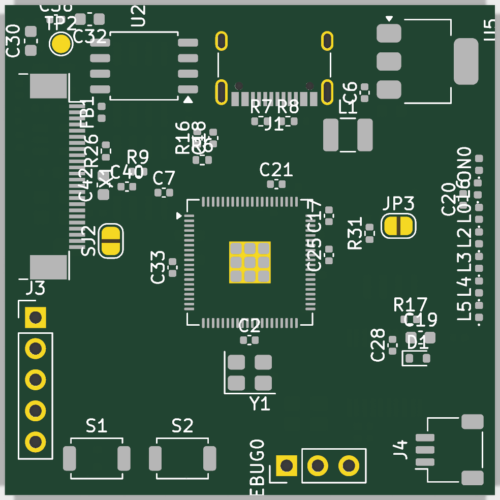
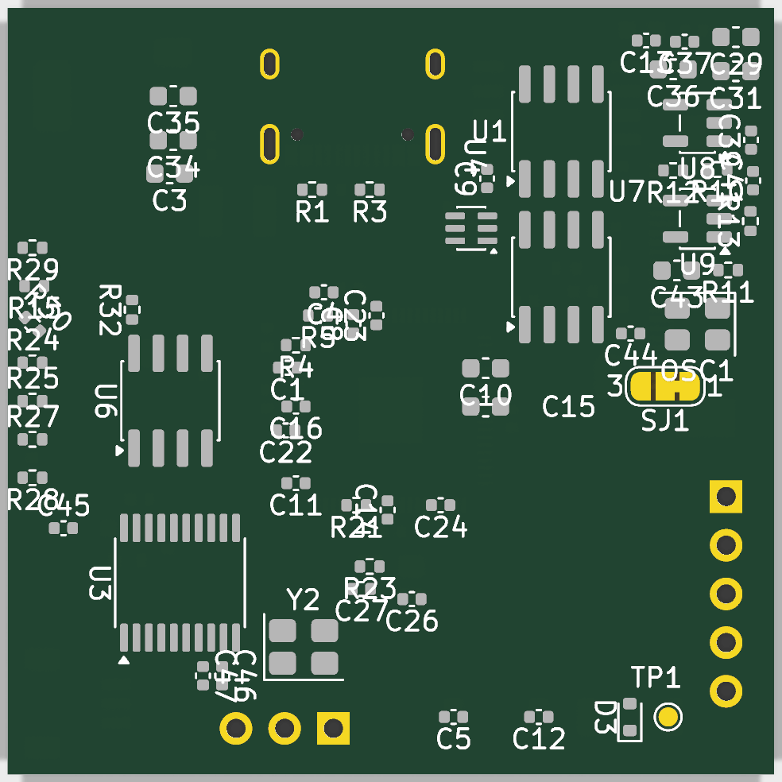
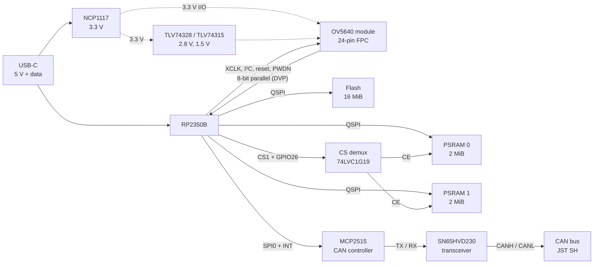

# Rp-2350-cam-module

A compact camera board for a satellite project, built around an **RP2350B** microcontroller and an **OV5640** 5-megapixel image sensor. Two external PSRAM chips (4 MiB in total) hold full-resolution frames until they are sent out over USB, and a CAN bus interface connects the board to the rest of the satellite.

<table>
  <tr>
    <td align="center"><br>proto2, top</td>
    <td align="center"><br>proto2, bottom</td>
  </tr>
</table>

proto2 as of October 2026: parts placed, not routed yet. proto1, the manufactured board, is pictured in [its README](hardware/proto1).

## Prototypes

| Prototype | Directory | Status | Summary |
|---|---|---|---|
| **proto1** | [`hardware/proto1`](hardware/proto1) | Manufactured, brought up | First board: RP2350B, flash, 2 × PSRAM, camera on a 2×9 header. Takes photos up to 2592 × 1944 (JPEG) and streams video over USB. |
| **proto2** | [`hardware/proto2`](hardware/proto2) | In design: schematic done, PCB placed but not routed | Moves the camera's supply and clock circuitry onto the board, wires the camera directly to the RP2350B and adds a CAN bus interface, on a 40 × 40 mm board. |

Each prototype directory has its own README with the details.

## proto2 at a glance

- **MCU:** RP2350B (QFN-80), 12 MHz crystal
- **Memory:** 16 MiB QSPI flash (W25Q128JVS) and 2 × 2 MiB PSRAM (APS1604M-3SQR-SN) on the same QSPI bus; one chip-select signal is steered to either PSRAM by a 74LVC1G19, so the two chips work as two switchable banks
- **Camera:** OV5640 module on a 24-pin FPC connector, with its 2.8 V and 1.5 V regulators on the board; 8-bit parallel (DVP) interface captured with a PIO state machine and DMA; XCLK from the RP2350 (an on-board 24 MHz oscillator can be fitted instead)
- **CAN bus:** MCP2515 controller on SPI0 and SN65HVD230 transceiver, JST SH connector, jumper-selectable 120 Ω termination
- **Interfaces:** USB-C (power and data), CAN, UART with flow control, SWD
- **Board:** 4 layers, 40 × 40 mm, parts on both sides



proto1 is the same design without the CAN bus, with the camera module on a 2×9 header and on a 41.6 × 78 mm board; see [its README](hardware/proto1).

## Repository layout

```
.
├── README.md
├── LICENSE                   CC BY-SA 4.0
├── NOTICE.md                 attribution of the Adafruit designs this is based on
├── hardware/
│   ├── proto1/               first prototype, sent to manufacturing
│   │   ├── README.md
│   │   ├── kicad/            KiCad project (schematic + PCB)
│   │   ├── fabrication/      gerbers, drill files, BOM, pick-and-place
│   │   └── docs/             schematic PDF, board renders
│   └── proto2/               second prototype, work in progress
│       ├── README.md
│       ├── kicad/
│       └── docs/             schematic PDF, board renders
└── scripts/
    └── export-docs.sh        regenerates a prototype's docs/ with kicad-cli
```

## Opening the designs

The designs are KiCad 10 projects. Open `hardware/<proto>/kicad/Adafruit Metro RP2350.kicad_pro`. The project is still called *Adafruit Metro RP2350* because it started from that board's design files.

If you only want to look, the schematic of proto1 is available as a PDF in [`hardware/proto1/docs`](hardware/proto1/docs/schematic.pdf).

To regenerate the schematic PDF and the renders after changing a design (needs `kicad-cli`):

```sh
scripts/export-docs.sh proto1
```

## Firmware

The firmware and the host tools are not part of this repository. The first prototype is driven by a Pico SDK program that captures the sensor's parallel output with PIO and DMA, buffers frames in the PSRAM and sends them to a Python tool over USB.

## Acknowledgements

The designs started from two open-source hardware projects by Adafruit Industries (designed by Limor Fried/Ladyada), both licensed under CC BY-SA 3.0:

- [Adafruit Metro RP2350](https://github.com/adafruit/Adafruit-Metro-RP2350-PCB): RP2350B symbols and footprints and the base schematic
- [Adafruit OV5640 Camera Breakout](https://github.com/adafruit/Adafruit-OV5640-Camera-Breakout-PCB): the camera header pinout, and the camera supply and clock circuit used in proto2 (schematic only, the layout is not copied)

[NOTICE.md](NOTICE.md) lists what was taken from each and what was changed, and reproduces Adafruit's original notices. This project is not affiliated with or endorsed by Adafruit.

## License

The contents of this repository are licensed under the [Creative Commons Attribution-ShareAlike 4.0 International](LICENSE) license (CC BY-SA 4.0). You may use, modify and manufacture the designs, also commercially, if you give credit and share your changes under the same license.
