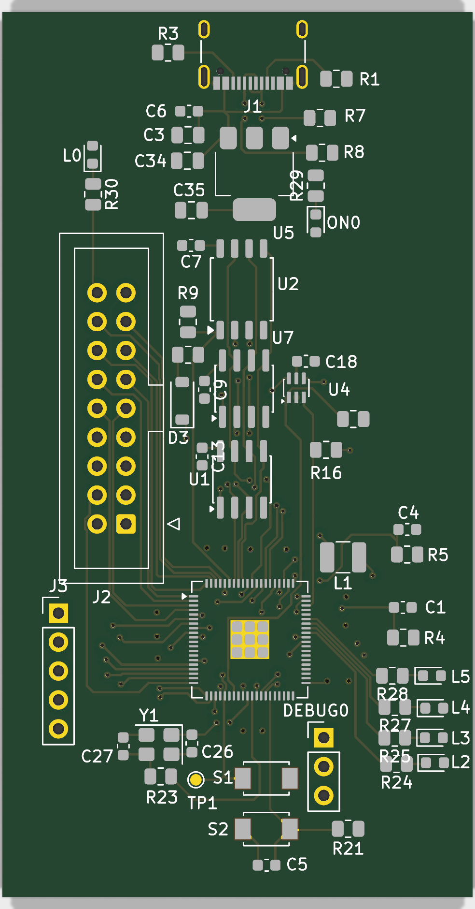
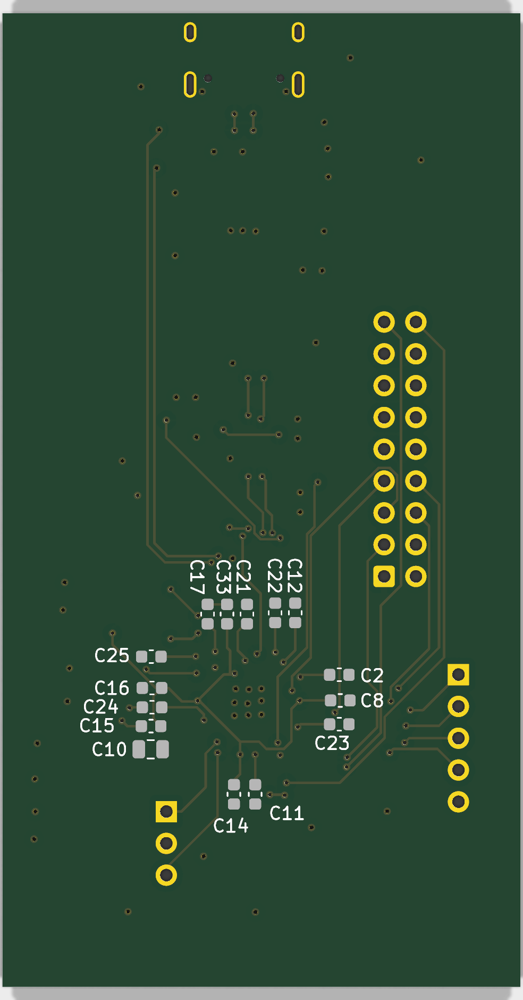

# proto1

First prototype of the camera module. Sent to manufacturing (JLCPCB assembly) in July 2026 and brought up with custom firmware: it captures photos up to the sensor's full 2592 × 1944 resolution and streams video over USB.

<table>
  <tr>
    <td align="center"> top</td>
    <td align="center"> bottom</td>
  </tr>
</table>

| | |
|---|---|
| Board | 4 layers, about 41.6 × 78 mm, 1.6 mm |
| MCU | RP2350B (QFN-80), 12 MHz crystal (Y1) |
| Flash | W25Q128JVS, 16 MiB QSPI |
| PSRAM | 2 × APS1604M-3SQR-SN, 2 MiB each (4 MiB in total) |
| Power | USB-C VBUS → NCP1117-3.3 → 3.3 V; the 1.2 V core supply comes from the RP2350's on-chip regulator with a 3.3 µH inductor (L1) |
| USB | USB-C receptacle (USB 2.0), 22 Ω series resistors on D+/D− |
| Camera | OV5640 module on the 2×9 header J2 |
| Debug | SWD header (DEBUG0), UART with flow control (J3) |
| Controls | USBBOOT (S1) and reset (S2) buttons, power LED and indicator LEDs |

## Files

| Path | Contents |
|---|---|
| [`kicad/`](kicad) | KiCad 10 project: schematic and PCB |
| [`fabrication/gerber/`](fabrication/gerber) | Gerbers (4 copper layers, mask, paste, silkscreen, edge cuts), drill files and the gerber job file |
| [`fabrication/bom.csv`](fabrication/bom.csv) | Bill of materials with LCSC part numbers |
| [`fabrication/`](fabrication) `*-all-pos.csv`, `*-all.pos` | Component positions for assembly |
| [`docs/`](docs) | [Schematic PDF](docs/schematic.pdf) and renders of the board |

The fabrication files were exported from KiCad 10.0.5 on 2026-07-28 and are meant for JLCPCB.

J2, J3, DEBUG0 and the test point TP1 are marked DNP in the BOM: the assembly service does not place them, the headers are soldered by hand.

## Connectors

Signal names are the schematic's net names; GPIO numbers are the RP2350B pins they are wired to.

### J2: camera (2×9)

The pin assignment is the same as on the 2×9 header of the Adafruit OV5640 breakout.

| Pin | Signal | RP2350 | | Pin | Signal | RP2350 |
|---|---|---|---|---|---|---|
| 1 | 3.3 V | | | 10 | D8 | GPIO7 |
| 2 | GND | | | 11 | D7 | GPIO4 |
| 3 | SCL | GPIO21 | | 12 | D6 | GPIO5 |
| 4 | SDA | GPIO20 | | 13 | D5 | GPIO2 |
| 5 | VSYNC | GPIO10 | | 14 | D4 | GPIO3 |
| 6 | HREF | GPIO9 | | 15 | D3 | GPIO0 |
| 7 | PCLK | GPIO11 | | 16 | D2 | GPIO1 |
| 8 | XCLK | GPIO8 | | 17 | RESET | GPIO22 |
| 9 | D9 | GPIO6 | | 18 | PWDN | GPIO23 |

The sensor's 8-bit output is D2 (LSB) to D9 (MSB).

### J3: UART (1×5)

| Pin | Signal | RP2350 |
|---|---|---|
| 1 | TX | GPIO16 |
| 2 | RX | GPIO17 |
| 3 | CTS | GPIO18 |
| 4 | RTS | GPIO19 |
| 5 | GND | |

TX and RX are named from the RP2350's point of view.

### DEBUG0: SWD (1×3)

| Pin | Signal |
|---|---|
| 1 | SWCLK |
| 2 | GND |
| 3 | SWDIO |

## PSRAM bank switching

The RP2350's QSPI memory interface has a single chip select for PSRAM (CS1, GPIO47). To use two PSRAM chips, both sit on the shared QSPI data and clock lines, and CS1 goes through a 74LVC1G19 (U4) that routes it to the chip-enable pin of one of them. GPIO26 selects which of the two chips receives the chip select, so software has to switch GPIO26 before it accesses the other bank. The flash (U2) has its own chip select and is unaffected.

## Known issues

- **Camera data lines are swapped in pairs.** On J2, D3 is wired to GPIO0, D2 to GPIO1, D5 to GPIO2, D4 to GPIO3, and so on, so each pair of adjacent data bits is exchanged. The firmware puts the bits back in order when it reads a frame out of the PSRAM.
